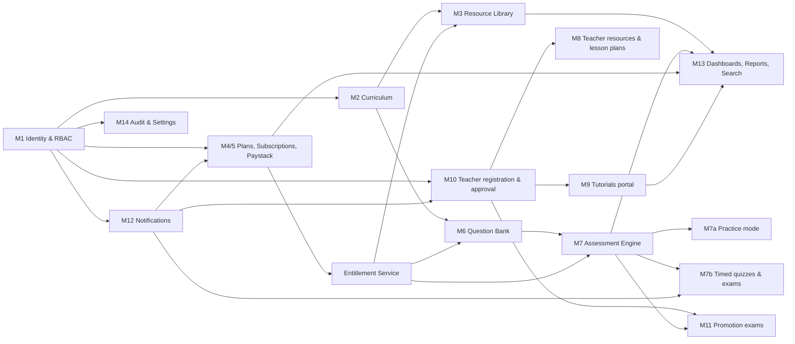
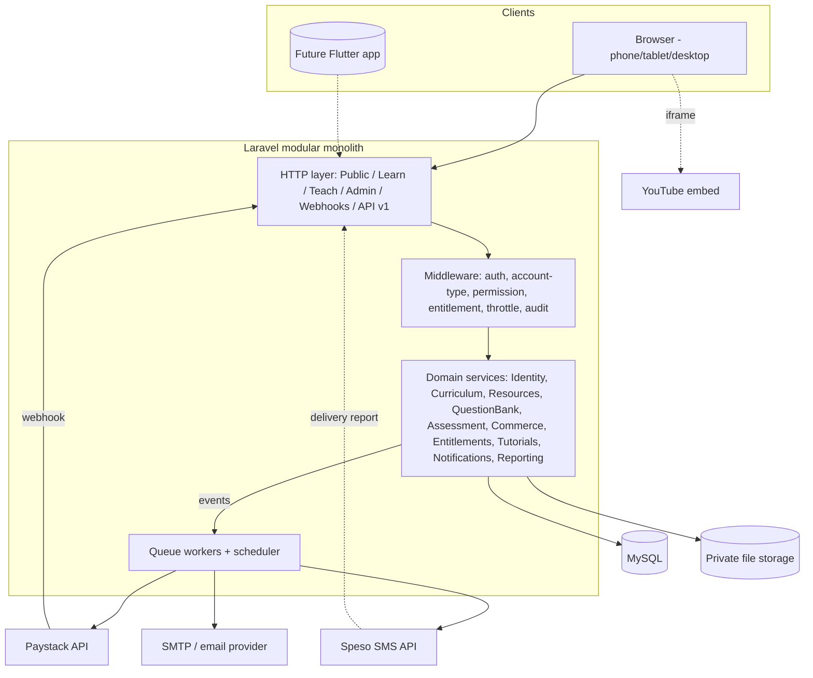
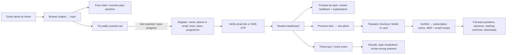
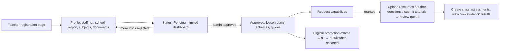
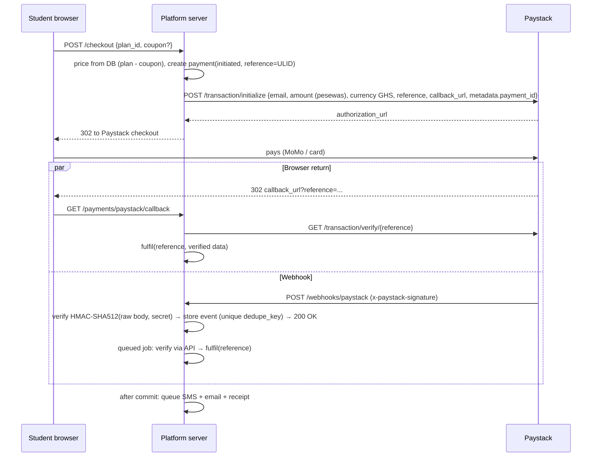
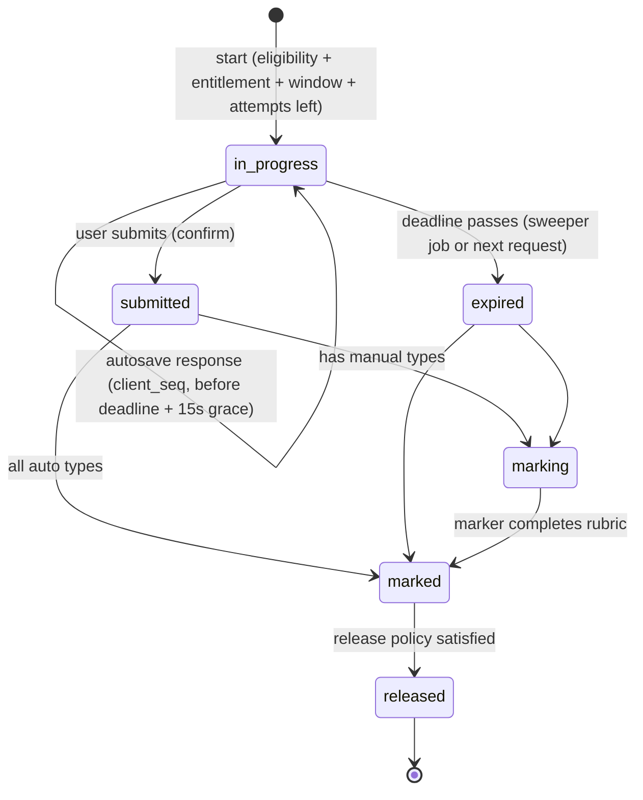

# Product Requirements & System Design Blueprint

**Project:** Ghana education learning, assessment and teaching platform (working folder `otisam`)
**Status:** Draft v0.1 for owner approval, 18 Oct 2026
**Scope of this document:** first-task deliverable (sections 1–14 of the master prompt). No application code has been written yet.

---

## 0. What I inspected first

The `otisam` folder is empty, so this is a new build. You asked me to base the account and admin architecture on two of your existing Laravel apps. Here is what each one contributes and what I will not carry over.

### `jhs_portal` (Laravel 12, PHP 8.2, Tailwind 4, Alpine, Spatie Permission 6)

| Keep (pattern or code) | Where it lives |
|---|---|
| Permission catalogue as a constant + default role map, re-seedable without clobbering custom roles | `database/seeders/RolesAndPermissionsSeeder.php` |
| Protected "Super Admin" role (cannot be edited/deleted); built-in roles can change permissions but not be renamed | `app/Http/Controllers/RoleController.php` |
| Route groups guarded by `permission:` middleware, sidebar driven by `@can`/`@canany` | `routes/web.php`, `resources/views/components/partials/sidebar-nav.blade.php` |
| Automatic audit trail of every successful write (route-name → category/noun map, never logs sensitive input, never breaks the request) | `app/Http/Middleware/RecordActivity.php` |
| Session idle timeout, forced password change on first login | `SessionTimeout.php`, `FirstLoginPasswordChange.php` |
| Teacher data scoping (teacher only sees own subjects/classes) | `app/Traits/ScopesToTeacher.php` |
| **Speso SMS gateway** (`https://business.speso.co/api/v1/messages/send`, bearer token) behind a provider switch, Ghana phone normalisation | `app/Services/SpesoSmsService.php`, `AppServiceProvider`, `app/Support/Phone.php` |
| Blade component kit: `app-layout`, `nav-group`, `nav-link`, `stat-tile`, `card`, `modal`, `dashboard-hero` | `resources/views/components/` |
| One feature-test file per module, plus an "every page loads" smoke test | `tests/Feature/` |

I am reading "SPSO SMS" in your brief as **Speso**, because `jhs_portal` already integrates it. Please confirm.

### `quizapp` (Laravel 10, Bootstrap 5, Spatie Permission)

| Keep (pattern) | Where it lives |
|---|---|
| Admin console shell: collapsible sidebar, top bar, grouped settings pages (Branding, Payment, Notifications, Security, SEO) | `layouts/admin.blade.php`, `Admin/Settings/*Controller.php` |
| Admin modules for Plans, Coupons, Payments, Results, Live exam monitoring, Tickets | `app/Http/Controllers/Admin/` |
| Ban/suspension middleware, login history, email-verification gate | `BanCheckMiddleware`, `LoginHistory`, `EnsureEmailIsVerifiedSystem` |
| Exam session + per-answer tables (concept) | `StudentExamSession`, `StudentExamAnswer` |

### Things I will deliberately not copy

| Found | Why it is not safe to reuse |
|---|---|
| `jhs_portal`: a `users.role` column (`admin`/`student`) that runs alongside Spatie roles | Two sources of truth. A Teacher, an Accountant and a Super Admin all show up as `role=admin`. I will use one `account_type` column for the account kind and leave all privileges to Spatie roles. |
| `quizapp` `AdminGate`: `$user->id === 1` passes every check | Hard-coded identity bypass. Super Admin will be handled by `Gate::before` on the role instead. |
| `quizapp` checkout: activates the plan from the browser callback, takes the amount from the session cart, never compares the paid amount, has no Paystack webhook and no idempotency | This fails acceptance criteria 7–9. Payments are redesigned from scratch (§7). |
| `quizapp`: Paystack secret key stored in the `system_settings` table and edited from the admin UI | Secrets will live only in `.env` or the host's secret store. The admin UI shows whether a key is set, never the key itself. |
| `quizapp`: `SubscriptionMiddleware` returns `$next()` unconditionally; the `Services/Exam/*` and `Services/Payment/*` files are empty | These are placeholders, so there is nothing to port. |
| `jhs_portal`: Tailwind and Alpine loaded from CDNs on every page (`cdn.tailwindcss.com`, `alpinejs@3.x.x`) | The Tailwind Play CDN is not meant for production, it is heavy on mobile data, and unpinned versions can break. Assets will be compiled with Vite. |
| `quizapp` code itself | It has an installer, an add-on system and an updater, which suggests it is a purchased script. I will reuse its ideas and layout, not its source, unless you confirm you own the rights to it. |

---

## 1. Product vision and name

**Vision:** A trusted Ghanaian learning platform where SHS (and later JHS) students learn from the current curriculum, practise with instant feedback, sit timed mock exams and unlock a premium library through one affordable subscription. Teachers get approved lesson materials, a question bank and professional practice exams. Everything is mapped to the official GES/NaCCA curriculum and works on a cheap phone over mobile data.

**Name:** I recommend keeping **Otisam** if it is already your brand, since it is short, neutral, and works as a domain and an SMS sender ID (≤11 characters). If it is only a folder name, two options:

- **Nimdeɛ** ("knowledge" in Twi): sender ID `NIMDE`, but the ɛ character causes trouble in URLs and SMS.
- **StudyGhana**: descriptive and easy to say, though less distinctive.

**Tagline idea:** *Learn it. Practise it. Pass it.*

Positioning for launch: **SHS 1–3 + WASSCE first**, then JHS/BECE (as you recommended).

---

## 2. Modules and dependencies



| # | Module | Hard dependencies | Notes |
|---|---|---|---|
| M1 | Identity, auth, RBAC, profiles | none | Built first; everything else checks permissions against it |
| M2 | Curriculum structure & versions | M1 | Admin editor, no hard-coded subjects |
| M3 | Resource library + secure file delivery | M1, M2, Entitlements | Past questions, solutions, marking schemes, notes |
| M4/5 | Plans, subscriptions, Paystack, coupons, reconciliation | M1, M12 | Notification failure must never roll back a payment |
| — | **Entitlement service** (shared) | M4/5 | The one place that answers "can this user access this premium thing right now?" |
| M6 | Question bank, revisions, import | M1, M2 | Answer keys stored apart from question content |
| M7 | Assessment engine (practice, quiz, exam) | M6, Entitlements | Server-authoritative timing |
| M10 | Teacher registration & verification | M1, M12 | Pending → approved/rejected |
| M8 | Teacher resources & lesson plans | M3, M10 | Reuses M3 with `audience=teacher` |
| M9 | Tutorials (YouTube embeds) & moderation | M2, M10 | Draft → submitted → approved/rejected → published |
| M11 | Teacher promotion/professional exams | M7, M10 | Eligibility rules, manual result release |
| M12 | Notifications (email, SMS, in-app) | M1 | Queue-backed, idempotent, templated |
| M13 | Dashboards, reports, search, exports | all | Built incrementally per module |
| M14 | Audit logs, settings, moderation, takedown | M1 | Audit middleware from day one |

---

## 3. Role-permission matrix

### 3.1 Account model

- **One `users` table**, with `account_type` set to `student`, `teacher` or `staff`. This says what kind of profile and dashboard the account gets. **It grants no privileges.**
- **Privileges come only from Spatie roles and permissions** (the `jhs_portal` pattern). Each permission is checked on the server by route middleware, policies or `Gate`. Sidebar `@can` checks only decide what is shown.
- **Super Admin** is a protected role. `Gate::before` returns true for it, it cannot be edited or deleted, and the last active Super Admin cannot be demoted or suspended.
- **Staff roles are presets**, and Super Admin can create more. Defaults: `Super Admin`, `Administrator`, `Content Manager`, `Exams Officer`, `Finance Officer`, `Moderator`.
- **Teachers** get the base `Teacher` role once approved. Extra capabilities (upload resources, author questions, publish tutorials, create class assessments) are separate permissions an admin grants per teacher, which meets acceptance criterion 4.
- A pending teacher holds the `Teacher (Pending)` role, which only covers profile and verification pages.
- **Guests** have no account. Their limits are configurable settings enforced by middleware and rate limits.

### 3.2 Permission catalogue (seeded constant, grouped)

| Group | Permissions |
|---|---|
| Users | `users.view`, `users.manage`, `users.suspend`, `teachers.verify`, `teachers.grant-capabilities`, `staff.manage`*, `roles.manage`* |
| Curriculum | `curriculum.view-admin`, `curriculum.manage` |
| Resources | `resources.manage`, `resources.publish`, `resources.moderate`, `resources.bulk-import`, `takedowns.manage` |
| Questions | `questions.manage`, `questions.review`, `questions.import`, `questions.view-keys` |
| Assessments | `assessments.manage`, `assessments.mark`, `results.view-all`, `results.release` |
| Promotion exams | `promotion-exams.manage`, `promotion-exams.release-results` |
| Tutorials | `tutorials.manage`, `tutorials.moderate` |
| Commerce | `plans.manage`, `coupons.manage`, `payments.view`, `payments.reconcile`, `subscriptions.adjust`, `refunds.record` |
| Comms | `notifications.send`, `notifications.view-logs`, `announcements.manage`, `templates.manage` |
| Reports | `reports.view`, `reports.export` |
| System | `settings.manage`, `integrations.status`*, `audit.view`, `system.maintenance`* |
| Teacher capabilities | `teach.upload-resources`, `teach.author-questions`, `teach.create-assessments`, `teach.publish-tutorials`, `teach.view-own-student-results` |

\* Super Admin only. These cannot be granted to any other role; this is enforced in `RoleController` validation, the same way `jhs_portal` validates against `PERMISSIONS`.

### 3.3 Matrix (defaults; ● = yes, ◐ = own/scoped records only, ○ = preview/limited, blank = no)

| Capability | Guest | Student | Teacher (pending) | Teacher (approved) | Moderator | Content Mgr | Exams Officer | Finance | Administrator | Super Admin |
|---|---|---|---|---|---|---|---|---|---|---|
| Browse subjects/topics, free resources | ● | ● | ● | ● | ● | ● | ● | ● | ● | ● |
| Preview premium resources | ○ | ○ | ○ | ○ | ● | ● | ● | | ● | ● |
| Full premium view/download | | ● if entitled | | ● if entitled† | ● | ● | ● | | ● | ● |
| Public practice quiz | ○ limited | ● | | ● | | | | | ● | ● |
| Save progress, bookmarks, history | | ● | | ● | | | | | | |
| Buy subscription | | ● | | ● | | | | | | |
| Timed quizzes/exams (student audience) | ○ public only | ● | | | | | | | | |
| Teacher lesson-plan library | | | | ● | ● | ● | | | ● | ● |
| Upload resources | | | | ◐ if granted (→ review) | | ● | | | ● | ● |
| Publish resources | | | | | ● | ● | | | ● | ● |
| Author questions | | | | ◐ if granted (→ review) | | ● | ● | | ● | ● |
| Review/approve questions | | | | | ● | ● | ● | | ● | ● |
| See answer keys in the bank | | | | ◐ own questions | | ● | ● | | ● | ● |
| Create class assessments | | | | ◐ if granted | | | ● | | ● | ● |
| Mark theory answers | | | | ◐ own assessments | | | ● | | ● | ● |
| Release results | | | | ◐ own class assessments | | | ● | | ● | ● |
| Submit tutorials | | | | ● (→ review) | | ● | | | ● | ● |
| Publish tutorials publicly | | | | only via approval, or `teach.publish-tutorials` | ● | ● | | | ● | ● |
| Take promotion exams | | | | ● if eligible | | | | | | |
| Manage promotion exams / release results | | | | | | | ● | | ● | ● |
| Verify/approve teachers, grant capabilities | | | | | | | | | ● | ● |
| Manage students & teachers | | | | | | | | | ● | ● |
| Plans & coupons | | | | | | | | ● | ● | ● |
| View payments, reconcile | | | | | | | | ● | ● | ● |
| Manual subscription adjustment (audited) | | | | | | | | ● | ● | ● |
| Send announcements / view delivery logs | | | | | | | | | ● | ● |
| Reports & exports | | | | ◐ own | | ◐ content | ◐ exams | ◐ finance | ● | ● |
| Curriculum editor | | | | | | ● | | | ● | ● |
| Settings & branding | | | | | | | | | ● | ● |
| Staff accounts, roles, integrations, maintenance | | | | | | | | | | ● |
| Audit log | | | | | | | | | ● | ● |

† Teachers buy the same subscription if they want the student premium library. Whether lesson plans are free for approved teachers or need a separate teacher plan is an open decision (§12, D7). Default: free for approved teachers at launch.

**Confidentiality rule:** no role sees promotion-exam questions through the question bank unless it holds `promotion-exams.manage`. This holds even for Content Managers.

---

## 4. Technology stack

| Layer | Choice | Why |
|---|---|---|
| Language/framework | **Laravel 12 on PHP 8.2+** | Same version as `jhs_portal`, which you already run and deploy; local XAMPP has PHP 8.2.12 |
| Database | **MySQL 8.0** in production (MariaDB 10.4 locally works) | You already use it; the whole design runs on InnoDB with FK constraints, `SELECT … FOR UPDATE` row locks and JSON columns. I avoid MySQL-only JSON functions in hot queries so MariaDB stays compatible. |
| Frontend | **Blade + Alpine.js + Livewire 3 (only where it pays off)** | Server-rendered pages are fast on low-end phones and keep business rules in one place. Livewire is limited to the exam player, question editor and filter panels; most pages stay plain Blade. No SPA. |
| Styling | **Tailwind CSS 4 compiled by Vite** with design tokens as CSS variables | Same as `jhs_portal`, but compiled and purged, so CSS stays small (target <30 KB gzip) |
| Auth/RBAC | Laravel session auth (Fortify for verification/reset/2FA flows), **spatie/laravel-permission 6** | Proven in both reference apps |
| Queues | **Laravel database queue** at launch; Redis when the host has it | Works on cPanel shared hosting; cron runs `schedule:run` every minute, and the schedule runs `queue:work --stop-when-empty` |
| Cache | File/database cache now, Redis later | No new infrastructure at launch |
| Files | Private `local` disk outside `public/`; S3-compatible disk (e.g. Cloudflare R2 or Wasabi) later through the same `Storage` interface | Premium files are never reachable by a URL alone |
| PDF previews | Queue job that cuts the first *N* pages with `setasign/fpdi` (or Ghostscript if the host has it); fallback: admin uploads a separate preview PDF | See risk R6 |
| PDF viewing | PDF.js reading from an authorised streaming endpoint | Renders on phones without a download |
| Maths | KaTeX (rendered client-side) for formulas in questions | Small and fast |
| Payments | **Paystack** REST API via Laravel `Http` client (no SDK needed) | Initialise, verify, webhooks |
| SMS | **Speso** adapter ported from `jhs_portal`, behind an `SmsGateway` interface, with a `LogSmsGateway` for dev/tests | Swappable |
| Email | SMTP/transactional provider (e.g. Mailgun, Brevo, Amazon SES) via Laravel Mail | Your choice (§14) |
| Excel/CSV | `maatwebsite/excel` (already used in `jhs_portal`) | Question and resource imports, report exports |
| PDF generation | `barryvdh/laravel-dompdf` (both apps use it) | Receipts, result slips |
| Testing | PHPUnit 11, Laravel HTTP fakes, a MySQL test database for locking tests | Same convention as `jhs_portal` |
| Errors/monitoring | Laravel log (daily, JSON) + Sentry free tier (optional) | |

**Architecture style:** a **modular monolith**. Code is grouped by domain under `app/Domain/<Module>` (models, services, policies, events), with thin controllers in `app/Http/Controllers/{Public,Learn,Teach,Admin,Webhooks}`. Modules talk to each other through service classes and events, never by reaching into another module's tables from a controller. Microservices are not justified at this scale. If a Flutter app comes later, it uses `/api/v1` (Sanctum tokens) on top of the same domain services.



---

## 5. Database architecture

Conventions: `bigint` PKs, ULIDs for anything that appears in a URL a user could guess (attempts, payments, files). Money is stored in **minor units (pesewas) as integers** with a `currency` char(3), never as floats. Every FK is indexed. Statuses are string columns validated by PHP enums, which is easier to migrate than MySQL `ENUM`. Soft deletes only where restoring is a real requirement (resources, questions, tutorials); users are deactivated or anonymised instead.

### 5.1 Core relationships

```mermaid
erDiagram
  USERS ||--o| STUDENT_PROFILES : has
  USERS ||--o| TEACHER_PROFILES : has
  USERS }o--o{ ROLES : "model_has_roles"
  ROLES }o--o{ PERMISSIONS : "role_has_permissions"

  EDUCATION_LEVELS ||--o{ CLASS_LEVELS : contains
  EDUCATION_LEVELS ||--o{ PROGRAMMES : offers
  PROGRAMMES }o--o{ SUBJECTS : "programme_subject"
  CURRICULUM_VERSIONS ||--o{ CURRICULUM_NODES : defines
  SUBJECTS ||--o{ CURRICULUM_NODES : "strand / sub-strand / indicator"
  CURRICULUM_NODES ||--o{ CURRICULUM_NODES : parent

  RESOURCES ||--o{ RESOURCE_FILES : stores
  RESOURCES }o--o{ CURRICULUM_NODES : "resource_curriculum_node"
  RESOURCES ||--o{ RESOURCE_LINKS : "solution_of / scheme_of"

  QUESTIONS ||--o{ QUESTION_REVISIONS : versions
  QUESTION_REVISIONS ||--|| QUESTION_KEYS : "answer key (restricted)"
  QUESTIONS }o--o{ CURRICULUM_NODES : tagged
  ASSESSMENTS ||--o{ ASSESSMENT_ITEMS : "fixed questions"
  ASSESSMENTS ||--o{ ASSESSMENT_RULES : "random draw rules"
  ASSESSMENTS ||--o{ ASSESSMENT_ELIGIBILITY : "who may sit"
  ASSESSMENTS ||--o{ ATTEMPTS : has
  USERS ||--o{ ATTEMPTS : makes
  ATTEMPTS ||--o{ ATTEMPT_QUESTIONS : "frozen paper"
  ATTEMPT_QUESTIONS ||--o| ATTEMPT_RESPONSES : answer
  ATTEMPT_QUESTIONS }o--|| QUESTION_REVISIONS : pins

  PLANS ||--o{ PAYMENTS : "priced from"
  USERS ||--o{ PAYMENTS : pays
  PAYMENTS ||--o| SUBSCRIPTIONS : activates
  USERS ||--o{ SUBSCRIPTIONS : holds
  COUPONS ||--o{ COUPON_REDEMPTIONS : used
  PAYMENT_WEBHOOK_EVENTS }o--o| PAYMENTS : "about"

  TUTORIALS }o--|| USERS : instructor
  NOTIFICATION_MESSAGES }o--|| USERS : to
  AUDIT_LOGS }o--o| USERS : actor
```

### 5.2 Table groups (major columns and constraints)

**Identity and access**
- `users`: `account_type`, `name`, `email` (unique), `phone` (E.164, unique nullable), `password`, `email_verified_at`, `phone_verified_at`, `status` (`active|pending|suspended|deactivated`), `must_change_password`, `last_login_at`. Indexes on `(account_type, status)`.
- `student_profiles` (1:1): `education_level_id`, `class_level_id`, `programme_id`, `school_name`, `region`, `is_minor`, `guardian_name`, `guardian_phone`, `guardian_consent_at`.
- `teacher_profiles` (1:1): `staff_number` (unique nullable), `current_rank`, `school_name`, `region`, `district`, `verification_status` (`pending|more_info|approved|rejected`), `verified_by`, `verified_at`, `decision_note`. `teacher_subjects` pivot. `teacher_documents` (private files: certificate, ID card, with `purge_after` for data minimisation).
- Spatie tables: `roles`, `permissions`, `model_has_roles`, `model_has_permissions`, `role_has_permissions`.
- `login_events` (success/fail, IP, UA, purged after 180 days), `password_reset_tokens`, `sessions`, `notification_preferences` (`user_id`, `category`, `channel`, unique triple).

**Curriculum**
- `education_levels`, `class_levels` (SHS 1–3, JHS 1–3…), `programmes` (General Science, General Arts, Business, Visual Arts, Home Economics, Agriculture, Technical, STEM pathways…), `subjects` (`code`, `name`, `category` core/elective, `education_level_id`), `programme_subject` (`is_core`).
- `curriculum_versions`: `education_level_id`, `name` (e.g. "SHS Curriculum 2023"), `effective_from`, `effective_to`, `status`, `source_document` (citation + file).
- `curriculum_nodes`: a self-referencing tree with `curriculum_version_id`, `subject_id`, `class_level_id`, `parent_id`, `node_type` (`strand|sub_strand|content_standard|indicator|topic|subtopic`), `code`, `title`, `statement`, `is_official`, `source_ref`, `sort`, `path` (materialised, for subtree queries). One tree supports both the newer NaCCA "strand / sub-strand / indicator" shape and the older syllabus "topic / subtopic" shape without schema changes.
- `academic_years`, `terms`.

**Resources**
- `resource_categories` (configurable: WASSCE past question, BECE past question, mock, solution, marking scheme, examiner report, lesson note, lesson plan, scheme of learning, teaching guide, worksheet, revision note, …).
- `exam_bodies` (WAEC, school, mock provider) and `exam_series` (e.g. "WASSCE May/June", "WASSCE Nov/Dec").
- `resources`: `category_id`, `title`, `slug` (unique), `description`, `audience` (`student|teacher|both`), `education_level_id`, `class_level_id`, `programme_id`, `subject_id`, `exam_body_id`, `exam_series_id`, `exam_year`, `paper_number`, `question_type`, `curriculum_version_id`, `access_level` (`free|premium|restricted`), `preview_pages`, `status` (`draft|in_review|published|archived`), `publish_at`, `published_at`, `author_id`, `copyright_holder`, `licence`, `permission_reference`, counters, soft deletes. Composite index on `(status, subject_id, category_id, exam_year)`.
- `resource_files`: ULID, `resource_id`, `role` (`main|preview|attachment`), `disk`, `path`, `original_name`, `mime`, `size`, `sha256`, `page_count`, `version`, `is_current`, `scan_status`.
- `resource_links` (`relation`: `solution_of|marking_scheme_of|related`, unique triple), `resource_curriculum_node`, `tags`/`taggables`.
- `resource_access_logs` (view/download/stream, user, IP; aggregated nightly, raw rows purged after 12 months).
- `moderation_reviews` (polymorphic: resources, questions, tutorials; decision, reviewer, note), `contributor_declarations`, `takedown_requests`.

**Questions and assessments**
- `questions`: identity and metadata only (`type`, `subject_id`, level/class/programme, `difficulty` 1–5, `default_marks` decimal(6,2), `status`, `access_level`, `confidentiality` (`practice|exam|promotion`), `author_id`, `owner_scope` (`platform|teacher`), `source`, `copyright`, `current_revision_id`).
- `question_revisions`: `question_id`, `revision_no` (unique pair), `stem` (sanitised HTML + KaTeX), `media` (json), `payload` (json: options, pairs, items; **no correctness flags**), `explanation`, `created_by`. Revisions are immutable; editing a question that has been used creates a new one.
- `question_keys` (1:1 with revision): `key` (json: correct option ids, accepted strings, numeric value + tolerance, correct order/pairs), `rubric` (json). This sits in its own table so that no delivery query can join it by accident. It is loaded only by the marking service and by users with `questions.view-keys`.
- `question_curriculum_node`, `question_imports` (file, status, validation report json, committed counts).
- `assessments`: `kind` (`practice_set|quiz|exam|promotion_exam`), `audience` (`students|teachers`), title/instructions, subject/level, `owner_id`, `opens_at`, `closes_at`, `duration_seconds`, `pass_mark`, `attempts_allowed`, `shuffle_questions`, `shuffle_options`, `negative_mark_ratio`, `allow_back_navigation`, `reveal_answers` (`never|after_each|after_submit|after_close|on_release`), `show_explanations`, `access_level`, `requires_login`, `status`, `results_policy` (`auto|manual_release`), `results_released_at`.
- `assessment_items` (fixed list: `question_id`, pinned `question_revision_id`, `position`, `marks`) and/or `assessment_rules` (random draw: criteria json + count + marks each).
- `assessment_eligibility`: `rule_type` (`all_approved_teachers|rank|region|district|subject|explicit_user|explicit_staff_number`), `value`.
- `attempts`: ULID, `assessment_id` (nullable for ad-hoc practice), `mode`, `user_id` (nullable for guest attempts, which carry a `guest_token` and are purged after 24 h), `attempt_no`, `status` (`in_progress|submitted|expired|marking|marked|void`), `started_at`, `deadline_at`, `submitted_at`, `submit_reason` (`user|timeout|admin`), `score`, `max_score`, `percentage`, `passed`, `entitlement_snapshot`. Unique `(assessment_id, user_id, attempt_no)`.
- `attempt_questions`: frozen paper (`attempt_id`, `position`, `question_revision_id`, `marks`, `option_order` json). Unique `(attempt_id, position)`.
- `attempt_responses`: `attempt_question_id` (unique), `response` json, `client_seq`, `saved_at`, `is_correct`, `marks_awarded`, `marked_by`, `marked_at`, `feedback`.
- `result_releases` (who requested, who approved, when), `bookmarks` (polymorphic, unique per user+item).

**Tutorials**
- `tutorials`: `title`, `slug`, `description`, `youtube_video_id` (validated 11-char id; full URLs are never stored and echoed back), `thumbnail_path`, subject/level/topic links, `instructor_id`, `learning_objectives` json, `status` (`draft|submitted|changes_requested|approved|rejected|published|archived`), `submitted_at`, `reviewed_by`, `published_at`, `view_count`.
- `tutorial_resources`, `tutorial_assessments`, `content_reports` (polymorphic). `playlists` / `playlist_items` / `tutorial_progress` come in Release 3.

**Payments and subscriptions**
- `plans`: `name`, `slug`, `duration_months` (3/6/12, configurable), `price_minor`, `currency` (default `GHS`), `benefits` json, `entitlement_key` (default `premium_standard`), `is_active`, `is_featured`, `sort`.
- `coupons` (`code` unique, `type` percent/fixed, `value`, plan scope, `starts_at`/`ends_at`, `max_redemptions`, `per_user_limit`), `coupon_redemptions` (`payment_id` unique).
- `payments`: ULID, `user_id`, `plan_id`, **`reference` (unique)**, `provider`, `amount_minor` (what we expect), `discount_minor`, `coupon_id`, `currency`, `status` (`initiated|pending|success|failed|abandoned|reversed|refunded`), `provider_transaction_id` (unique nullable), `channel`, `paid_at`, `verified_at`, `verification_source` (`callback|webhook|reconcile`), `provider_payload` (json, sanitised), `failure_reason`.
- `payment_webhook_events`: `provider`, `event_type`, **`dedupe_key` (unique: sha256 of event + data.id + data.reference)**, `signature_valid`, `payload`, `received_at`, `processed_at`, `error`, `attempts`.
- `subscriptions`: `user_id`, `plan_id`, **`payment_id` (unique nullable)**, `entitlement_key`, `source` (`payment|admin_grant|coupon_free|migration`), `starts_at`, `ends_at`, `grace_ends_at`, `status` (`active|revoked|refunded`), `granted_by`, `reason`. Index `(user_id, entitlement_key, ends_at)`.
- `refunds`, `receipts` (`payment_id` unique, sequential `number` unique), `reconciliation_runs`, `permanent_grants` (`user_id`, `resource_id`, reason, granted_by).

**Notifications and operations**
- `notification_templates` (`event_key`, `channel`, `locale`, `subject`, `body`, `is_active`; unique triple).
- `notification_messages`: **`idempotency_key` (unique)**, `event_key`, `category` (`security|transactional|academic|marketing`), `user_id`, `channel`, `recipient` (stored masked after sending), `body_preview`, `status` (`queued|sent|delivered|failed|suppressed`), `provider`, `provider_message_id`, `attempts`, `last_error`, `sent_at`, `delivered_at`.
- `announcements`, `audit_logs` (insert-only: actor, action, auditable_type/id, `old`/`new` json with secrets redacted, IP, UA, `created_at`), `settings` (non-secret key/value grouped like quizapp's settings groups), `support_requests`, `contact_messages`, `report_snapshots` (nightly aggregates for dashboards).

### 5.3 Transaction boundaries

| Operation | Inside one DB transaction |
|---|---|
| Payment fulfilment | lock payment row → validate → mark success → create subscription → coupon redemption → receipt. Notifications are dispatched **after commit**. |
| Attempt start | eligibility/entitlement check → create attempt → freeze `attempt_questions` |
| Attempt submit | conditional status flip `in_progress → submitted` → auto-mark → store totals |
| Question import commit | all valid rows or none |
| Teacher approval | profile status + role swap + audit + queued notification (after commit) |
| Result release | set `results_released_at` + `result_releases` row; notifications after commit |

---

## 6. User journeys

### Student


### Teacher


### Administrator
1. Dashboard alerts: *5 teacher approvals pending, 12 resources in review, 3 payments pending > 30 min, 2 SMS failures*.
2. Approve a teacher: view documents → approve → choose capabilities → teacher gets SMS + email.
3. Upload a WASSCE paper: metadata form (subject, year, series, paper) → upload PDF → preview auto-generated → link solution and marking scheme → set Premium → publish now or on a schedule.
4. Build a mock exam: draw 40 MCQs from "Integrated Science / SHS 2 / difficulty 2–4" → 90 min → reveal after close → publish.
5. Finance: payments list, filter `pending`, press "Re-verify with Paystack" → reconciliation result recorded in the audit log.

### Payment (detailed in §7)
Choose plan → (coupon) → server creates `payment` row and calls Paystack initialise → user pays on Paystack (MoMo prompt / card) → Paystack redirects back **and** sends a webhook → both paths call one `PaymentFulfilment::fulfil($reference)` that **verifies with Paystack's API** → subscription active → "Payment received" page and notifications. The success page only *reads* the state; it never creates it.

---

## 7. Subscription lifecycle and premium-access enforcement

### 7.1 Payment and activation flow



**`fulfil()` rules**, all on the server inside a transaction with `SELECT … FOR UPDATE` on the payment row:

1. If the payment is already `success`, return it and change nothing. This is the idempotency guarantee.
2. Require `verify.status == "success"`, `verify.reference == payment.reference`, `verify.amount == payment.amount_minor`, and `verify.currency == payment.currency`. Any mismatch → mark `failed` with a reason, raise an alert, no subscription.
3. Create the subscription. **Stacking policy:** `starts_at = max(now, latest active ends_at for the same entitlement)`, `ends_at = starts_at + plan.duration_months`. Buying while still subscribed extends the subscription; the remaining days are not lost.
4. `subscriptions.payment_id` is unique, so even a bug elsewhere cannot create two subscriptions for one payment.
5. Record `verification_source` and write the audit entry.

**Other states:**
- `pending` (MoMo approval not yet given): the page shows "Waiting for confirmation" and polls our own status endpoint, which never trusts the client. The **reconciliation command** runs every 10 minutes and re-verifies `initiated|pending` payments younger than 48 h. After that they are marked `abandoned`.
- `failed` / `abandoned`: user notified once with a "Try again" link.
- **Refunds:** recorded from the `refund.processed` webhook or by Finance. By default the linked subscription is revoked (`status=refunded`); Finance can choose "keep access" with a reason. Both are audited.
- **Admin adjustments** (extend, grant, revoke) create or alter `subscriptions` rows with `source=admin_grant`, `granted_by` and a required reason. They show up in the audit log and in the user's history.
- **No recurring billing assumed.** Renewal is a fresh purchase. Reminders go out 7 days and 1 day before expiry (email + SMS, deduplicated), and again on the expiry day. Paystack Plans/Subscriptions can be added later behind the same `fulfil()`.
- **Grace period:** a setting (default 0 days). If set, `grace_ends_at = ends_at + N days`.
- **Webhook hardening:** signature check on the raw body; optional allowlist of Paystack's published webhook IPs; webhooks are acknowledged within ~1 s and processed in a job; unknown events are stored and ignored.

### 7.2 Entitlement enforcement

A single `EntitlementService` answers questions like `can($user, 'premium_standard', $at = now())` and `canAccessResource($user, $resource)`. The order of checks:

1. Staff permission (`resources.manage`, etc.) → allow.
2. `resource.access_level == free` → allow (subject to audience: teacher-only items need an approved teacher).
3. A `permanent_grants` row → allow.
4. An active subscription whose `entitlement_key` matches and where `starts_at ≤ now < coalesce(grace_ends_at, ends_at)` → allow.
5. Otherwise → preview only.

The result is memoised per request. It is enforced in these places, all on the server:

| Surface | Enforcement point |
|---|---|
| Resource detail page | Policy decides between "preview" and "full" view |
| PDF stream / download | `ResourceFileController` checks the policy on **every** request, streams from the private disk, sends `Cache-Control: private, no-store`, logs access; download links are short-lived signed URLs (5 min) that are *also* policy-checked when used |
| Preview | Only the generated `preview` file is ever served to non-entitled users, never the full file with JavaScript hiding pages |
| Solutions / marking schemes | Same policy (they are resources linked by `resource_links`) |
| Question explanations in practice | The practice API only includes the explanation if the question is free or the user is entitled |
| Premium assessments | Checked when the attempt starts; the result is stored in `attempt.entitlement_snapshot` |
| Search results | Show premium items with a lock badge and their metadata only |

**What happens if a subscription expires mid-quiz:** an attempt that started while the user was entitled **runs to its own deadline and is marked normally**, and the score stays visible in the user's history. After expiry, *reviewing* premium explanations and starting new premium attempts needs a valid subscription again. This follows from the snapshot rule and will be stated in the Terms.

---

## 8. Question bank, assessments and promotion exams

### 8.1 Question types: one strategy class per type

Each type implements a `QuestionType` interface:

```php
validateDefinition(array $payload, array $key): ValidationResult  // used by editor and importer
publicPayload(QuestionRevision $r, ?array $optionOrder): array      // what the candidate sees, never the key
normaliseResponse(mixed $raw): array                                // validate and shape the answer
mark(array $response, array $key, float $marks, MarkingPolicy $p): MarkResult  // auto types only
requiresManualMarking(): bool
```

| Type | Auto-marked | Key format | Notes |
|---|---|---|---|
| MCQ (single) | ● | option id | options shuffled per attempt, ids stay stable |
| Multiple select | ● | set of option ids | policy: all-or-nothing (default) or partial credit with penalty |
| True/False | ● | bool | |
| Fill-in-the-blank | ● | per blank: accepted strings, case/space/punctuation normalisation, optional regex (admin only) | |
| Numerical | ● | value + absolute or relative tolerance + optional unit | |
| Matching | ● | pairs | partial credit per correct pair |
| Ordering | ● | sequence | all-or-nothing or adjacency credit |
| Short answer | ◐ | accepted answers (auto-suggest) + manual confirm | |
| Structured/theory | manual | rubric json (criteria, marks) | marking queue |
| Essay | manual | rubric | marking queue |

Adding a new type later means writing one new class, registering it, and adding an editor partial.

Content safety: stems are sanitised HTML using an allowlist (HTMLPurifier). Images are re-encoded on upload. Formulas use KaTeX syntax.

**Import:** Excel/CSV template per type. The first pass is a dry run: it validates every row (missing key, unknown subject/topic code, duplicate stem by normalised hash, option count, tolerance), shows a report, and only commits on confirmation. The commit is all-or-nothing.

**Review workflow:** teacher-authored questions go `draft → in_review → published | changes_requested`. Reviewers need `questions.review`. Once a question has been used in an attempt, its revision can never be edited in place.

### 8.2 Practice and formal assessments are separate modes

| | Practice (self-test) | Quiz / mock exam | Promotion exam |
|---|---|---|---|
| Who | guests (limited), students, teachers | students | eligible teachers only |
| Question source | free/premium questions with `confidentiality=practice` | practice or exam pools | `confidentiality=promotion` pool only |
| Feedback | instant per question, explanation | per `reveal_answers` setting | never per question; results on release |
| Timer | optional, soft | server-enforced | server-enforced |
| Attempts | unlimited | configured | configured (usually 1) |
| Persisted | users: yes; guests: session only, 24 h | yes | yes, audited |
| Back-navigation | yes | configurable | configurable |

### 8.3 Attempt lifecycle (server-authoritative)



- `deadline_at = min(started_at + duration, closes_at)`, computed and stored **on the server**. The browser timer only displays `deadline_at − server_now`, which the server sends with every save response, so changing the device clock has no effect.
- **Autosave:** `PUT /attempts/{ulid}/answers/{position}` with `client_seq`. The server ignores a stale `seq`, rejects anything after `deadline_at + 15 s` (to absorb network latency), and returns `{saved_at, server_now, deadline_at}`. Answers are also kept in `localStorage` and resent after a network drop. The UI shows *Saved*, *Saving…* or *Not saved – retrying* without hiding failures.
- **Refresh/resume:** reloading picks up the same attempt (one `in_progress` attempt per user per assessment) with saved answers.
- **Submit is idempotent:** `UPDATE attempts SET status='submitted' … WHERE id=? AND status='in_progress'`. If 0 rows change, it returns the existing result. A double click or retried request cannot submit twice.
- **Expiry sweeper:** runs every minute and auto-submits expired attempts. Any request touching an expired attempt also finalises it on the spot.
- **Frozen paper:** `attempt_questions` pins revision ids and option order, so editing the bank later never changes a paper someone has already sat.
- **No answer leakage:** the player endpoint builds its payload from `publicPayload()` and never loads `question_keys`. Correctness and explanations are only returned when the `reveal_answers` policy allows it, and that is checked on every request. An automated test asserts that no key fields appear in the player JSON or HTML.
- **Scoring:** `marks_awarded` per item (negative marking floored at 0 per paper unless configured otherwise), totals, percentage, pass/fail, and a per-topic breakdown via `curriculum_nodes`.

### 8.4 Teacher promotion and professional exams

- An `assessment` with `kind=promotion_exam`, `audience=teachers`, and a question pool restricted to holders of `promotion-exams.manage`.
- **Eligibility:** rules are combined (any matching *include* rule, then *exclude* rules). Types: all approved teachers, rank, region/district, subject, explicit list imported by staff number. The check runs when the exam is listed **and** when an attempt starts.
- **Maker-checker release:** the Exams Officer marks results ready, and a second user with `promotion-exams.release-results` approves. Both are audited.
- **Audit:** question changes, scheduling, eligibility changes, every attempt start/submit, every manual mark change (old → new, who, why) and release.
- **Labelling:** the UI and certificates say *"Practice / professional assessment administered by <Platform>"*. Nothing is called an official GES promotion exam unless you hold written authorisation, which would be stored as a setting with a document reference.
- Results can be exported to Excel for administrators.

---

## 9. Page structure and dashboard layouts

### 9.1 Sitemap

```
Public (/)
├─ Home · About · Subjects (/subjects/{level}/{subject}/{topic})
├─ Past questions (/past-questions?subject=&year=&series=&paper=)
│   └─ Resource detail (/resources/{slug})  preview · solution status · download
├─ Practice (/practice)  · Quizzes (/quizzes)
├─ Tutorials (/tutorials, /tutorials/{slug})
├─ Plans (/plans) · Checkout (/checkout/{plan})
├─ Teachers (/teachers - landing + register)
├─ Search (/search?q=)
├─ Help centre · Contact · Terms · Privacy · Copyright & takedown
└─ Auth: /login · /register · /teachers/register · /verify · /forgot-password

Student (/learn)
├─ Dashboard · My subjects · Practice history · Quizzes & exams · Results
├─ Saved (bookmarks) · Subscription & payments (receipts) · Notifications · Profile/preferences

Teacher (/teach)
├─ Dashboard (verification banner) · Lesson plans & resources · My uploads
├─ My questions · My assessments · Marking queue · Tutorials (drafts / in review / published)
├─ Professional exams (eligible · history · results) · Profile & documents

Admin (/admin)  - sidebar groups shown by @can, enforced by route middleware
├─ Dashboard
├─ People: Students · Teachers (+ approval queue) · Staff* · Roles*
├─ Curriculum: Levels/classes · Programmes · Subjects · Versions · Topic tree editor
├─ Content: Resources · Bulk upload · Categories · Review queue · Takedowns
├─ Assessment: Question bank · Imports · Assessments · Marking · Results release
├─ Promotion exams: Exams · Eligibility · Monitoring · Results
├─ Tutorials: All · Moderation queue · Reports
├─ Commerce: Plans · Coupons · Payments · Subscriptions · Reconciliation · Refunds
├─ Communication: Announcements · Templates · Delivery logs
├─ Reports & exports
└─ System: Settings (Branding, Access & guest limits, Notifications, Security) · Integrations status* · Audit log · Maintenance*
```

### 9.2 Layouts

The admin shell follows **quizapp's console layout**: a left sidebar with collapsible groups, a top bar with search, notifications and profile, and a content area. It is built with **jhs_portal's Blade components** (`x-app-layout`, `x-nav-group`, `x-stat-tile`, `x-card`) in Tailwind.

| Breakpoint | Behaviour |
|---|---|
| < 640 px (phone) | Single column; sidebar becomes an off-canvas drawer; student/teacher areas get a **bottom tab bar** (Home, Practice, Library, Results, Me); tables collapse to cards; 44 px touch targets |
| 640–1024 px | Two-column card grids; sidebar becomes an icon rail |
| > 1024 px | Full sidebar; dashboards in a 12-column grid |

**Student dashboard:** greeting and subscription chip (Active until 12 Jan / Expired → Renew) · Continue learning · Recommended for SHS 2 Science · Available quizzes and upcoming exams · Recent results (sparkline) · Subject performance bars · Saved items.

**Teacher dashboard:** verification status banner · capability chips · tutorial submission statuses · my question bank counts by status · my assessments · assigned professional exams · marking queue count.

**Admin dashboard:** stat tiles (students, teachers, active subscribers, 30-day revenue) · approval queues (teachers, resources, questions, tutorials) · payment health (pending > 30 min, failed today) · recent transactions · upcoming exams · popular subjects and resources · SMS/email delivery rates · recent audit activity.

**Exam player (phone first):** sticky header with timer and save status; one question per screen; bottom bar with Prev / Flag / Next; a question-palette drawer showing answered, flagged and unanswered; a submit screen listing unanswered questions.

### 9.3 Design tokens (starting point)

```css
:root {
  --color-primary: #13294B;   /* deep navy */
  --color-primary-600: #1E3A8A;
  --color-accent: #C9A227;    /* restrained gold */
  --color-success: #15803D;   /* green, also used as Ghana accent */
  --color-danger: #B91C1C;
  --color-surface: #FFFFFF;
  --color-bg: #F7F8FA;
  --color-text: #111827;
  --color-muted: #4B5563;     /* ≥ 4.5:1 on white */
  --radius: 0.75rem;
  --font-sans: "Inter", system-ui, sans-serif;  /* self-hosted, subset */
}
```

Every component has defined loading, empty, error and success states. Focus rings are always visible. Target: WCAG 2.2 AA (contrast, focus not obscured, 24 px minimum targets, no drag-only interactions, accessible authentication with no cognitive puzzles).

---

## 10. Security, privacy, performance and testing

### 10.1 Security controls

| Threat | Control |
|---|---|
| Broken access control / IDOR | Policies on every model route; ULIDs for attempts, payments and files; queries scoped to the owner (`$user->attempts()->findOrFail`); a test suite that tries to read another user's records |
| Privilege escalation | Role and permission edits need `roles.manage` (SA only); SA-only permissions are not assignable; users cannot edit their own roles; last-SA guard; every change audited |
| Answer leakage | Keys in a separate table, presenter pattern, reveal policy checked per request, promotion pools hidden from the bank, tests that grep responses for key data |
| Premium file theft | Private disk, policy per request, short-lived signed links, separate preview files, access logging, anomaly alert (e.g. > 50 downloads/day per user); download watermarking in Release 3 |
| Payment fraud / replay | Server-side verify, amount/currency/reference match, HMAC-verified webhooks, unique `dedupe_key`, row locks, `payment_id` unique on subscriptions |
| CSRF / XSS / SQLi | Laravel CSRF (webhook route excluded but signed), Blade escaping, HTMLPurifier for rich text, Eloquent/bindings only, CSP header (no inline scripts outside nonce) |
| Uploads | Extension and MIME allowlist (PDF, DOCX, PPTX, XLSX, PNG, JPG, WEBP; **no** `.docm/.pptm/.svg/.html`), size limits per type, random names, stored outside web root, ClamAV adapter if the host has it, image re-encode |
| Brute force | Login throttle (5/min per account+IP), OTP throttle, guest quiz throttle, CAPTCHA-free (accessibility) with progressive delays |
| Sessions | Secure, HttpOnly, SameSite=Lax cookies; HTTPS only + HSTS; session regenerated on login; 30-min idle timeout for staff (jhs_portal pattern), longer for students; TOTP 2FA mandatory for staff in Release 2 |
| Secrets | `.env` only; admin UI shows "configured ✓"; logs scrub `password`, `token`, `authorization`, `secret`, card data; Paystack payloads stored after removing authorisation codes |
| Audit | `RecordActivity` middleware (from jhs_portal) + explicit domain audit events for payments, subscription adjustments, marks and releases |
| Dependencies | `composer audit` + `npm audit` in CI; monthly update window |
| Backups | Nightly DB dump + weekly files, encrypted, kept off-server (30 daily / 12 monthly); quarterly restore drill (acceptance criterion 20) |

### 10.2 Privacy (Act 843 and minors)

- Collect only what is needed. Students: name, phone *or* email, level, class, programme. School, region and date of birth are optional; the account asks "Are you under 18?" instead of a full date of birth.
- Under-18 accounts: a guardian contact can be added, marketing messages are off by default and cannot be turned on without guardian consent recorded, and no public profile or leaderboard shows full names (initials only).
- Teacher verification documents are held privately, seen only by `teachers.verify`, and deleted 90 days after the decision.
- Users can export their data and request deletion; deletion anonymises the account but keeps financial records as the law requires.
- Register with the **Data Protection Commission** of Ghana as a data controller before launch and publish a privacy notice (legal advice recommended).
- SMS bodies never include passwords or full payment details.

### 10.3 Performance and reliability

- Pages target < 150 KB first load on 3G (compiled Tailwind, no heavy JS framework, lazy images, WebP thumbnails, `loading=lazy` YouTube facades so the iframe loads only on tap).
- Eager loading everywhere (N+1 checks in tests with `Model::preventLazyLoading()` in non-production), pagination on every list, composite indexes for library filters, cached curriculum tree and plan list (invalidated on change).
- Heavy work queued: PDF previews, imports, exports, notifications, report snapshots.
- Exam load: autosave is one small indexed write. Load test target: 500 concurrent candidates saving every 15 s on the chosen host before any national-scale mock.
- Offline: only what is built — answers are buffered in localStorage and resent when the connection returns. No claim of full offline mode.

### 10.4 Testing strategy

| Level | What |
|---|---|
| Unit | Marking per question type, tolerance, negative marking, subscription stacking/expiry/grace, entitlement decisions, coupon maths, eligibility rules, phone normalisation |
| Integration | Paystack initialise/verify via `Http::fake` with recorded real sandbox responses, webhook signature verification, Speso adapter, mail, file streaming, preview generation, import validation |
| Feature (per module, jhs_portal style) | Registration/verification, teacher approval, uploads, resource access, checkout, timed attempt lifecycle, result release, every-page-loads per role |
| Security | Each of: privilege escalation, other-user records, answer leakage, forged callback, unsigned/duplicate webhook, oversized/malicious upload, expired subscription |
| Concurrency | Two webhook jobs + callback for one reference at the same time on MySQL → exactly one subscription; double submit → one result |
| UAT | Scripted walkthroughs for guest, student, teacher, admin, super admin covering the 20 acceptance criteria |
| Accessibility & mobile | axe checks on key pages, manual pass on a low-end Android over throttled 3G |

The 20 acceptance criteria are tracked one-to-one in `docs/CHECKLIST.md`.

---

## 11. Implementation roadmap

Size estimates assume one developer working with me. They are relative effort, not promises.

| Phase | Contents | Exit criteria |
|---|---|---|
| **P0 Foundations** (S) | Laravel 12 skeleton, Vite + Tailwind tokens, base layouts ported from jhs_portal/quizapp patterns, CI test run, `.env.example`, settings model, audit middleware | App boots, tests green, layout on phone/desktop |
| **P1 Identity & RBAC** (M) | Registration (student/teacher), email verify + SMS OTP, login/reset, profiles, Spatie catalogue + default roles, staff management, role editor, suspension, teacher approval queue + capabilities | AC 2, 3 (part), 4, 18 (part) |
| **P2 Curriculum** (M) | Levels, classes, programmes, subjects, versions, tree editor, CSV import of topics | AC 17 |
| **P3 Resource library** (L) | Resource CRUD + bulk upload, private storage, preview generation, PDF.js viewer, links (solution/marking scheme), filters/search, public pages | AC 1 (part), 5 |
| **P4 Commerce** (L) | Plans, coupons, checkout, Paystack initialise/verify/webhook, fulfilment, reconciliation, receipts, entitlement service wired to resources | AC 6–11 |
| **P5 Question bank** (L) | Type strategies (objective types first), editor, revisions/keys, import with dry-run, review workflow | — |
| **P6 Assessment engine** (L) | Practice mode (guest + user), quizzes/exams, player, autosave, sweeper, marking, results, reports | AC 1, 12–14 |
| **P7 Notifications** (M) | Templates, preferences, queue jobs, Speso + email channels, delivery logs, expiry reminders | AC 16 |
| **— MVP release (SHS/WASSCE) —** | hardening, UAT, DPC registration, content loading, soft launch | |
| **P8 Teacher portal** (M) | Lesson plans/schemes library, teacher uploads → review, class assessments, manual marking queue, theory/essay types | |
| **P9 Tutorials** (M) | YouTube tutorials, workflow, moderation, reports | AC 3 |
| **P10 Promotion exams** (M) | Eligibility, restricted pools, maker-checker release, exports | AC 15 |
| **P11 Reports, search, hardening** (M) | Unified search, report snapshots, exports, staff 2FA, backups + restore drill, deployment guide | AC 19, 20 |
| **R3 Later** | JHS/BECE content, playlists/courses, learning paths, watermarking, PWA, Flutter API, AI-assisted marking (human-reviewed) | |

**Order change from the brief:** I build Commerce (P4) before the Question bank (P5) because the entitlement service it delivers is needed by both the library and the assessment engine, and because getting paid content live is the earliest point where the platform earns money. Notifications are stubbed with a log channel until P7, so earlier modules can raise events without waiting on it.

---

## 12. Risks, assumptions and open decisions

### Risks

| # | Risk | Impact | Mitigation |
|---|---|---|---|
| R1 | **WAEC owns the copyright in WASSCE/BECE papers.** Selling access to scanned papers without a licence is a legal risk. | High | Get a WAEC licence, **or** sell your own worked solutions, explanations and practice questions "in the style of" past papers. Per-resource `copyright_holder`, `licence` and `permission_reference` fields, contributor declarations and a takedown process are built in. **Needs your decision before content loading.** |
| R2 | Curriculum transition: candidates may be on the older SHS syllabus while newer cohorts follow the newer NaCCA SHS curriculum | Medium | Curriculum versions with effective dates; resources and questions can map to both. You need to supply the official documents; I will not invent indicators. |
| R3 | Shared hosting limits (no long-running workers, no Ghostscript, PHP time limits) | Medium | Cron-driven queue, FPDI previews with uploaded-preview fallback; recommend a small VPS before exam-season traffic |
| R4 | Mobile money confirmations arrive late | Medium | Pending state, webhook + reconciliation job, clear user messaging |
| R5 | Speso delivery reports and webhook format are not documented in jhs_portal | Low | Ship send + status "submitted"; add delivery callbacks once docs are confirmed |
| R6 | FPDI's free parser cannot read some compressed PDFs (PDF ≥ 1.5 object streams) | Medium | Detect failure → ask the admin for a preview file or use Ghostscript where available; commercial FPDI parser as an option |
| R7 | Exam-day traffic spikes | Medium | Lightweight autosave, load test, staggered windows, VPS |
| R8 | Students sharing one subscription login | Medium | Concurrent-session limit (e.g. 2 devices) as a setting; alerts on unusual download volume |
| R9 | Teacher identity verification without a GES API | Medium | Manual document review; staff number uniqueness; capability grants separate from approval |
| R10 | Using quizapp code that may be under a commercial licence | Low-Med | Reuse patterns only unless you confirm rights |

### Assumptions (I will proceed on these unless you say otherwise)

- A1. "SPSO SMS" = **Speso** (`business.speso.co`), same integration as jhs_portal.
- A2. Launch scope = **SHS 1–3 + WASSCE**; JHS/BECE comes later.
- A3. One premium entitlement (`premium_standard`) sold as 3/6/12-month plans with different prices; buying again extends access (stacking).
- A4. Currency GHS; prices entered in cedis, stored in pesewas.
- A5. Approved teachers get the lesson-plan library free at launch.
- A6. Production hosting is cPanel-style shared hosting like jhs_portal (inferred from `cgi-bin`, `error_log`, `ssl-manager.php` in that repo), moving to a VPS when traffic grows.
- A7. English-only UI at launch; strings go through `__()` so Twi/other languages can be added.
- A8. Guest limits: 10 practice questions per day per device/IP, no downloads, 2-page previews (all configurable).
- A9. Separate brand and codebase from jhs_portal and quizapp; no shared database or single sign-on with them.

### Decisions confirmed by the owner (18 Oct 2026)

| # | Decision |
|---|---|
| D2 | **Premium content = the platform's own worked solutions, explanations and practice questions.** WAEC papers are not resold. Any scanned WAEC paper that is published is free and carries attribution, subject to a rights check. |
| A1 | SMS provider is **Speso**. It uses the same API key, sender ID and base URL as jhs_portal (copied into `.env` only). |
| D3 | **cPanel shared hosting** at launch, so the queue runs from cron and there are no long-running workers. |
| D4 | **Students sign up with a phone number and an SMS OTP.** Email is optional. |
| R10 | quizapp source code may be reused. The admin console shell (layout, sidebar, top bar, CSS, JS) is ported from it. |

### Open decisions

| # | Decision | Default if no answer |
|---|---|---|
| D1 | Product name and domain | "Otisam" placeholder in config |
| D2 | WASSCE content rights (R1) | Build all features; load only content you have rights to |
| D3 | Hosting: shared vs VPS for launch | Shared-compatible design |
| D4 | Student sign-up: phone-first (SMS OTP) or email-first | Either one is required; phone + OTP preferred because many students lack email |
| D5 | Plan prices | Admin-configurable; seeded with placeholder prices marked "set before launch" |
| D6 | Device/session limit per subscriber | 2 concurrent sessions |
| D7 | Teacher access to lesson plans: free, or a teacher plan | Free for approved teachers |
| D8 | Is a GES-authorised body involved in promotion exams? | Labelled as practice/professional assessments |
| D9 | Email provider | SMTP via `.env`, provider of your choice |

---

## 13. MVP and later releases

**MVP (Release 1: SHS/WASSCE commercial launch)**
- Guest browsing, search, free resources, premium previews, public practice with limits.
- Student registration (phone OTP or email), dashboard, bookmarks, history.
- Admin: curriculum editor; resource library with bulk upload, previews and solution/marking-scheme links; question bank (MCQ, multi-select, true/false, fill-blank, numerical) with import; practice sets, timed quizzes and mock exams; results and reports.
- Subscriptions: 3/6/12-month plans, coupons, Paystack (MoMo + card) with webhook, reconciliation and receipts; expiry reminders.
- Notifications: email + Speso SMS for registration, verification, reset, payment, subscription, results.
- Teacher registration and approval (so the teacher base can grow before the teacher portal opens).
- RBAC, audit log, settings, backups, deployment guide.

**Release 2 (teachers)**
- Teacher resource portal and lesson plans, teacher uploads and question authoring with review.
- Theory, essay, matching and ordering questions; manual marking.
- Class assessments and results for teachers.
- Tutorials portal with moderation.
- Promotion and professional exams.
- Staff 2FA, unified search improvements, report exports.

**Release 3 (scale)**
- JHS/BECE, playlists and courses, learning paths and progress.
- Download watermarking, PWA install, Flutter app on `/api/v1`, analytics snapshots, AI-assisted marking as a human-reviewed aid, recurring billing if Paystack plans fit.

---

## 14. What I need from you before production integration

| Item | Needed by | Notes |
|---|---|---|
| Product name, logo, domain, SMS sender ID (≤ 11 chars, registered with Speso) | P0 / P7 | |
| **Paystack**: business account (Ghana), **test** public/secret keys now, live keys at launch, webhook URL registered in the dashboard, MoMo channels enabled | P4 | Keys go into `.env` only. Do not paste live keys in chat. |
| **Speso**: API key, sender ID, confirmation that the jhs_portal endpoint is current, delivery-report/webhook docs if available | P7 | |
| Email provider SMTP credentials and a sending domain (SPF/DKIM) | P1 | |
| Official GES/NaCCA curriculum documents for each launch subject (PDFs) and which version applies to which SHS cohort | P2 | I will only enter what the documents say |
| **Content rights**: WAEC licence or a written content strategy; list of contributors and agreements | before content load | R1 |
| Launch subjects and programmes, and plan prices | P2 / P4 | |
| Hosting details (cPanel vs VPS, PHP version, cron access, whether Ghostscript/ClamAV/Redis exist) | P0 | |
| Teacher verification policy (documents to request, who approves) | P1 | |
| Legal: Terms, Privacy Notice and DPC registration (lawyer review) | before launch | I can draft templates for counsel to review |
| Promotion-exam authority, if any | P10 | D8 |
| Confirmation on reusing quizapp source code (licence) | P0 | R10 |
